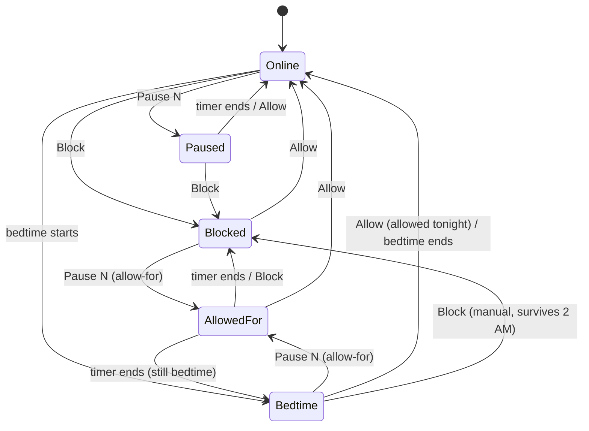

# Parental Controls for Home Assistant — design

Status: Stage 3 built (core control, device lists, card). Stage 4 (HACS polish, CI, brands) next.

## Goal

Give parents a simple screen per child to block, pause and schedule a child's internet on their home router,
installable from HACS and set up entirely from Home Assistant's UI. It replaces a hand-built setup (6 scripts,
4 automations, about 30 helpers, template sensors, a command-line sensor, a pasted Python file and a generated
dashboard) with one integration and one card.

In scope: per-child control on a router (block, pause, allow-for, bedtime), per-device control and device status.
Out of scope: DNS filtering such as NextDNS (a separate integration later).

## Concepts

| Term | Meaning |
|---|---|
| Child | A person with one router group, e.g. "Riley". Any number of children. |
| Router group | The router's own list of the child's devices. Blocking a child blocks the group. Kept in the router. |
| Manual block | The parent's standing choice: blocked until Allow. |
| Pause | Blocked for N minutes, then back to whatever applies. |
| Allow-for | Online for N minutes, then back to whatever applies. What Pause becomes while a child is blocked. |
| Bedtime | A nightly window per child (weeknight start, weekend start for Fri and Sat nights, one end time). |
| Allowed tonight | Set by Allow during bedtime: online for the rest of that night only. |
| Group device | A device in a child's router group. It follows the child's block. |
| Extra device | A device outside the group, shown on the child's screen (e.g. Kobo, Xbox, Echo Show). |
| Device control | An optional per-device block, on either kind of device. |

## Rules

Whether a child is blocked right now is derived from stored intent, in this order:

1. A running override wins: Pause blocks, Allow-for allows.
2. Otherwise bedtime blocks, unless the child is allowed tonight.
3. Otherwise the manual setting.

| Event | What happens |
|---|---|
| Pause while online | Paused for N minutes, then online. |
| Pause while blocked or in bedtime | Allow-for N minutes, then blocked again (or bedtime, if still bedtime). |
| Pause while a pause or allow-for runs | Restarts it with the new length. |
| Block | Manual block. Cancels any pause or allow-for. Survives the end of bedtime. |
| Allow | Clears the manual block and any pause or allow-for. During bedtime: allowed tonight. |
| Bedtime starts | Cancels any pause or allow-for; resets "allowed tonight". A manual block stays underneath. |
| Bedtime ends | Lifts only bedtime's block; resets "allowed tonight". A manual block stays. |
| Router changed outside HA | Unblocked counts as Allow (cancels a running pause); blocked counts as Block. |
| Home Assistant restarts | State is saved with absolute end times; on start-up, anything that ended while down is applied. |

These are the cases in `tests/test_engine.py`, taken from the behaviour of the current setup.

## Devices (optional, router-specific)

- The setup can search the router's known clients with a wildcard on name, hostname or MAC (e.g. `*kobo*`),
  online or not, and lists matches by name and last seen (no MACs on screen) under **Can be blocked** (in the
  child's group, or with its own No Internet rule that has a switch in HA) or **Status & traffic only**.
- Whether a device gets its own block control is read from the router's rules, not chosen: the integration matches
  each picked device to a rule switch, and re-matches by itself when the router integration adds or removes one.
- Two kinds, both kept:
  - **Extra device** (outside the group): listed on the child's screen; only its own control can block it.
  - **Group device with its own control**: block just that one device while the rest of the group stays online.
- Precedence: the child's block always wins for group devices. A device control only adds a restriction; it
  cannot let a device through its child's block.
- Device status (online, access point, signal, speeds) is fetched only while the Devices view is open (opening it
  turns Live on, which refreshes every 5 s and stops by itself after 5 minutes) or on Check, never continuously,
  and is not written to Home Assistant's history.

## Router providers

The rules know nothing about any router. A provider (`provider.py`) supplies:

- search clients, list groups, live status and speeds for chosen devices;
- block or allow a child's group; block or allow one device;
- read the current block state, so changes made in the router's own app are noticed.

UniFi is the first provider. Per-device blocks on UniFi need a per-device rule on the router. For now the parent
creates those rules in UniFi and the integration finds them (read-only access). Creating those rules from Home Assistant
needs a UniFi login with write access and is planned for later, behind the same interface.

## What Home Assistant shows

Per child:

| Entity | Purpose |
|---|---|
| `sensor.<child>_internet` | Online / Paused / Allowed for / Bedtime / Blocked, with `ends_at` and `then` attributes |
| `button.<child>_block`, `button.<child>_allow`, `button.<child>_pause` | The status-card actions, and Pause for the set length |
| `number.<child>_pause_minutes` | The Custom slider |
| `switch.<child>_bedtime` and three `time` entities | Bedtime on/off and its times |
| `sensor.<child>_devices` | Devices online at the last check; the list (status, AP, signal, speeds, block state) is an unrecorded attribute |
| `button.<child>_check_devices`, `switch.<child>_live_devices` | Fetch now; refresh every 5 s, off by itself after 5 min (the card turns Live on when Devices is opened) |
| Per picked device: `binary_sensor.<device>_online`, `sensor.<device>_blocking`, `binary_sensor.<device>_blocked` | Online at the last check; "Follows <child>" / "Own block rule" / "Status & traffic only"; Blocked only with its own rule (the card switches the router's rule directly) |

Services: `parental_controls.block`, `.allow`, `.pause` (child, minutes), `.refresh_devices` (child).

Entries: one "router" entry holds the UniFi console address and a view-only login; each child is its own entry. A child's options hold its block switch, router group and picked devices (`{mac: {name, block_entity}}`).

One card, `custom:parental-controls-card` with `entity: sensor.riley_parental_controls_internet`, draws the status card with its Block/Allow button,
the Pause section and the Devices list. Adding a child in the integration adds its entities; adding a tab is one
card on a new view.

## Stages

| Stage | Delivers | Replaces |
|---|---|---|
| 0 | This spec, the rules engine and its tests | nothing yet |
| 1 | Integration with children, block/pause/allow, bedtime, restart handling | scripts, automations, helpers, template sensors |
| 2 | Devices: search and pick in the UI, live status, device controls | command-line sensor, pasted Python file |
| 3 | The card with a visual editor | button-card/Mushroom templates, dashboard generator |
| 4 | HACS packaging, CI, docs, translations, GitHub | |

Each stage runs alongside the current setup and moves one child at a time, with the old pieces kept until the new
ones have run cleanly.
